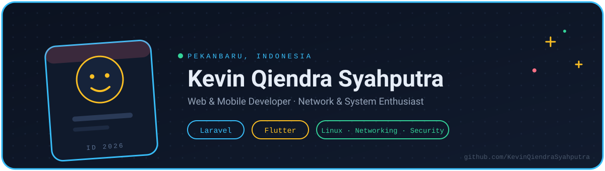

  

## Sekilas

Saya membangun aplikasi web dan mobile: sistem kasir yang dipakai kasir sungguhan setiap hari, absensi sekolah berbasis QR, dan aplikasi keuangan mobile yang tetap jalan tanpa internet. Stack utama saya Laravel untuk backend, Flutter untuk mobile, dan JavaScript untuk antarmuka.

Saat ini siswa **SMK Muhammadiyah 2 Pekanbaru** di bidang Teknologi & Rekayasa, dan alumni PKL di **PT PLN Icon Plus Riau**. Di luar pengembangan aplikasi saya mengurus Linux, jaringan, dan keamanan sistem — karena aplikasi yang sudah di-deploy tetap butuh server yang tidak tumbang.

**Sekarang:** Laravel + MySQL untuk sistem berbasis web, Flutter untuk mobile yang serius, dan Red Hat / Cisco untuk sisi infrastruktur.
**Terbuka untuk:** proyek freelance, magang, dan kolaborasi teknis.

## Proyek

| | |
|:--|:--|
| **Aplikasi Kasir Sederhana** POS multi-role: stok otomatis, cetak struk, laporan harian. `Laravel` `MySQL` `Bootstrap` | **Absensi Siswa QR Code** Pencatatan kehadiran real-time lewat scan QR dinamis. `PHP` `MySQL` `JavaScript` |
| **Catatan Keuangan Mobile** Offline-first, pemasukan/pengeluaran dengan grafik bulanan. `Flutter` `Dart` `SQLite` | **Interactive Terminal Portfolio** Web personal dengan physics canvas, lanyard ID, dan terminal CLI. `HTML5` `CSS3` `JavaScript` |
| **Bot Automation Lab TKJ** Utilitas automasi untuk kebutuhan praktikum jaringan dan sistem. `Python` | **[Lihat semua repositori →](https://github.com/KevinQiendraSyahputra?tab=repositories)** Kode lengkap, commit history, dan proyek lain. |

## Sertifikasi

| Lembaga | Sertifikat |
|:--|:--|
| Red Hat | RH124 — Red Hat System Administration I |
| Cisco Networking Academy | CCNA: Introduction to Networks |
| Cisco Networking Academy | Introduction to Cybersecurity |
| DQLab | Introduction to Data Science with R |

## Kontak

  
  
  

Terima lewat email kalau ada proyek, atau DM Instagram untuk hal yang lebih cepat.
